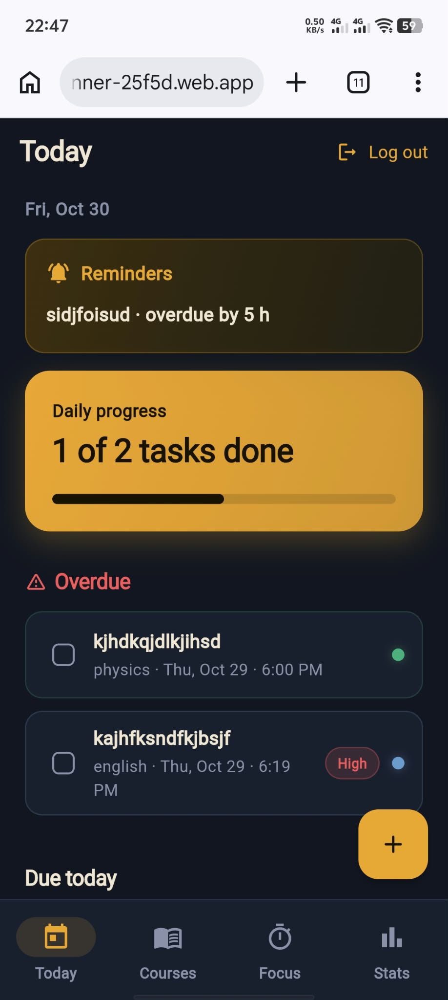
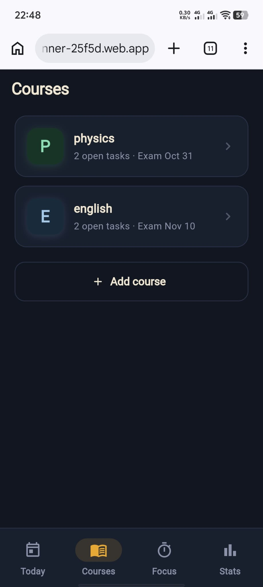
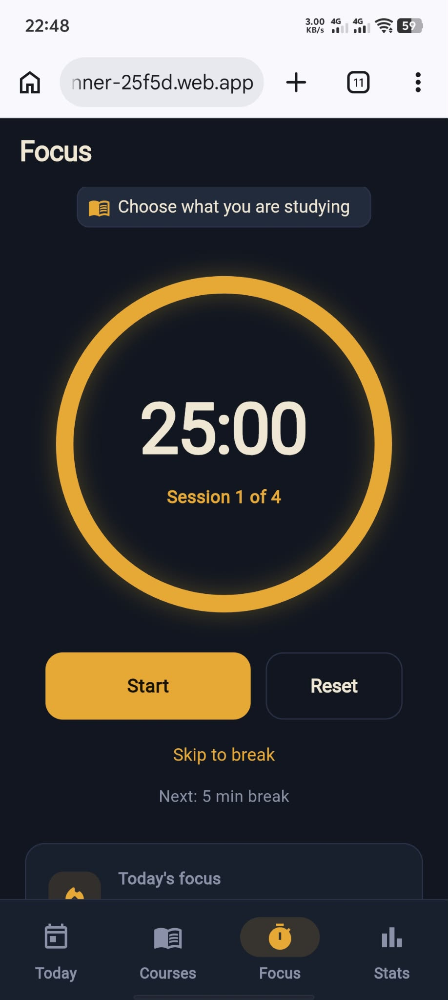
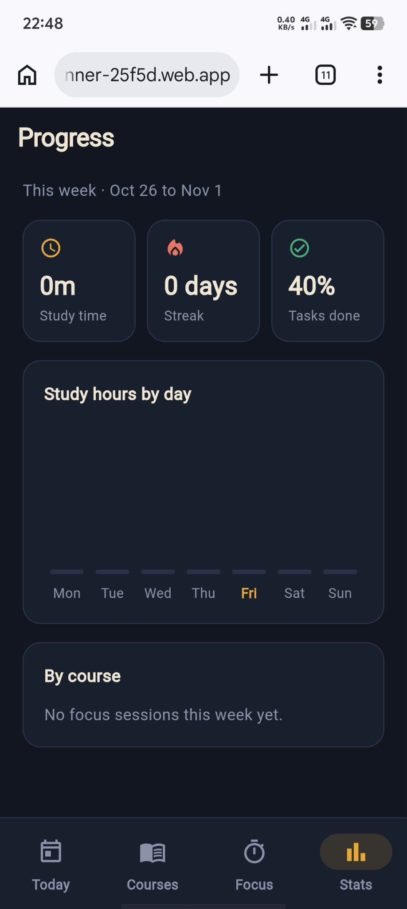

# StudyPlanner

A study planner for students. Keep your courses, deadlines, and study time in one place, stay focused with a Pomodoro timer, and see your weekly progress.

**Live demo:** https://study-planner-25f5d.web.app

Create a free account to try it. Each account only sees its own data.

## Screenshots

| Today | Courses | Focus | Stats |
|---|---|---|---|
|  |  |  |  |

## Features

- **Accounts:** sign up, log in, and log out with email and password.
- **Courses:** add courses with a color and an optional exam date. Each course shows its open task count.
- **Tasks:** add tasks with a course, due date and time, priority, and notes. Edit, mark done, or delete them.
- **Today screen:** daily progress, tasks due today, an overdue section, and what is coming up in the next 7 days.
- **Reminders:** choose none, at due time, 1 hour before, or 1 day before. Reminders appear as a card on the Today screen.
- **Focus timer:** 25 minute focus sessions with 5 minute breaks (4 sessions per cycle). Pause, resume, reset, or skip. Each finished session is saved with its course and task.
- **Progress:** study time this week, current streak, task completion rate, hours by day, and hours by course.

## Tech stack

| Area | Choice |
|---|---|
| App | Flutter (Dart) for web, with an Android project configured |
| State management | Riverpod |
| Navigation | go_router (with a bottom navigation shell) |
| Backend | Firebase Authentication and Cloud Firestore |
| Hosting | Firebase Hosting |
| Testing | flutter_test |

## Project structure

The code is organized by feature. Each feature keeps its data access, state, and screens together.

```
lib/
  core/          theme, course colors, date helpers, clock
  shell/         bottom navigation shell
  features/
    auth/        sign in, create account, auth repository
    courses/     course list, add course, course repository
    tasks/       tasks, add/edit, task detail, task repository
    today/       Today screen
    focus/       Pomodoro timer, session repository
    stats/       progress screen and stats calculations
  router.dart    routes and login redirects
  main.dart      app startup
```

Data flows in one direction: **Firestore repository → Riverpod provider → screen**. Screens never talk to Firestore directly.

## Data model

All data lives under the signed-in user.

| Path | Fields |
|---|---|
| `users/{uid}` | name, email, createdAt |
| `users/{uid}/courses/{id}` | name, colorIndex, examDate (optional), createdAt |
| `users/{uid}/tasks/{id}` | title, courseId, dueAt, priority, notes, remindBefore (minutes, optional), done, completedAt, createdAt |
| `users/{uid}/sessions/{id}` | courseId (optional), taskId (optional), seconds, endedAt |

## Security

Firestore Security Rules let each user read and write only their own documents:

```
rules_version = '2';
service cloud.firestore {
  match /databases/{database}/documents {
    match /users/{userId} {
      allow read, write: if request.auth != null && request.auth.uid == userId;
    }
    match /users/{userId}/{document=**} {
      allow read, write: if request.auth != null && request.auth.uid == userId;
    }
  }
}
```

## Getting started

### Prerequisites

- [Flutter SDK](https://docs.flutter.dev/get-started/install)
- [Node.js](https://nodejs.org) and the Firebase CLI (`npm install -g firebase-tools`)
- A Firebase project (the free Spark plan is enough)

### Setup

1. Clone the repository and install packages:

   ```bash
   git clone https://github.com/estrellanoeljohn-lab/study-planner.git
   cd study-planner
   flutter pub get
   ```

2. In the Firebase console, enable **Email/Password** sign-in under Authentication, create a **Firestore** database, and publish the security rules above.

3. Connect the app to your own Firebase project. This regenerates `lib/firebase_options.dart`:

   ```bash
   dart pub global activate flutterfire_cli
   flutterfire configure
   ```

4. Run the app:

   ```bash
   flutter run -d chrome
   ```

## Tests

```bash
flutter test
```

The tests cover the weekly stats calculations (study time, streak, completion rate) and the reminder time logic.

## Deployment

```bash
flutter build web --release
firebase deploy --only hosting
```

## Known limitations

- Reminders only appear while the app is open. There are no phone notifications yet.
- The focus timer stops if the browser tab is closed.
- Courses cannot be edited or deleted in the app yet.
- The Android project is configured, but the app has not been built or published for Android.

## Roadmap

- Android notifications for reminders, even when the app is closed
- Edit and delete courses
- Calendar view with deadline days
- Settings screen (reminder defaults, timer lengths, dark mode)
- Subtasks and study groups

## Author

Built by [@estrellanoeljohn-lab](https://github.com/estrellanoeljohn-lab) as a personal portfolio project. The screens were designed first as a prototype, then built with Flutter and Firebase.
